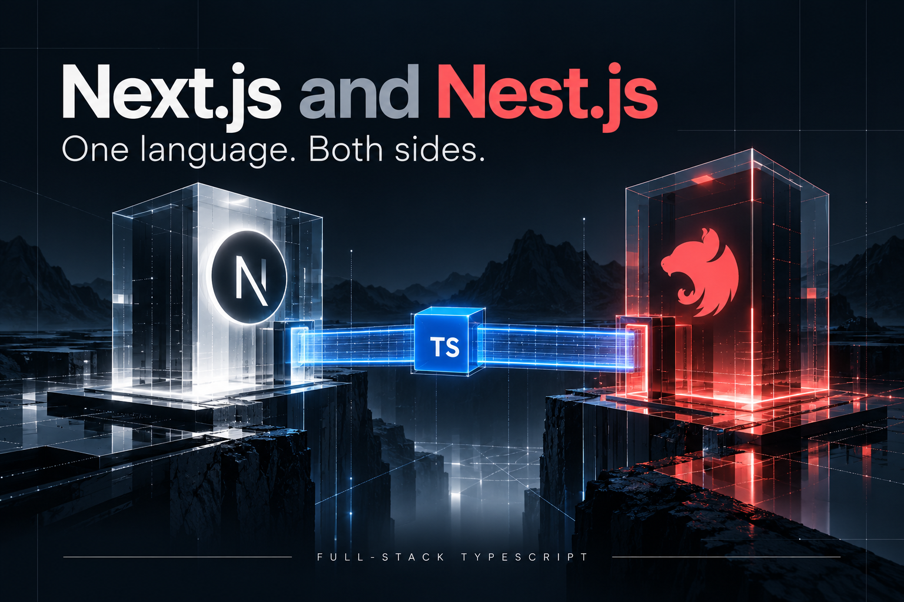
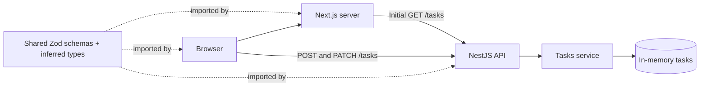

<p align="center"></p>

# Next.js and Nest.js

**One language. Both sides.** A hands-on full-stack TypeScript tutorial: build a Next.js interface, connect a NestJS REST API, and share a contract that validates real data.

This repository is a complete npm workspace. Clone it, install once, and start both applications with one command. The example is a small task board: read tasks, add a task, and mark it complete.

## Quick start

Use **Node.js 22.12+** (Node 22 LTS recommended), npm 10+, and Git.

```sh
git clone https://github.com/Skeeb32/Next.js-and-Nest.js.git
cd Next.js-and-Nest.js
npm ci
npm run dev
```

Open **http://localhost:3000**. The API runs at **http://localhost:4000/tasks**. Wait for both servers to finish starting; use the retry link if the web app loads first. Stop both with Ctrl+C.

Defaults work without environment files. To customize them:

```sh
cp apps/api/.env.example apps/api/.env
cp apps/web/.env.example apps/web/.env.local
```

| Variable | Application | Purpose |
| --- | --- | --- |
| `PORT` | API | API port; defaults to `4000` |
| `WEB_ORIGIN` | API | Allowed browser origin; defaults to `http://localhost:3000` |
| `API_URL` | Web server | Server-side API address; defaults to `http://localhost:4000` |
| `NEXT_PUBLIC_API_URL` | Browser | Browser-reachable API address; same default |

Restart after environment changes. Public variables are embedded in the frontend at build time: never put secrets in them. When changing the API port, update both API URLs.

## What you will learn

- Configure npm workspaces with a real shared package.
- Separate HTTP routing, business logic, and UI rendering.
- Infer TypeScript types from reusable runtime schemas.
- Fetch initial data in a Server Component and handle interactions in a Client Component.
- Validate incoming requests **and** outgoing API responses.
- Handle loading, validation, empty, and connection-error states.

## Architecture



The shared package is a build-time dependency and a runtime validation library, not an HTTP hop. The browser communicates directly with NestJS for mutations, so the API enables CORS for the configured web origin.

```text
apps/
  api/src/
    main.ts                  Bootstrap, CORS, port
    app.module.ts            Application composition
    tasks/                   Controller, service, module
  web/
    app/                     Page, task board, layout, styles
    lib/api.ts               Server-side fetch + validation
packages/contracts/src/
  index.ts                   Schemas and inferred types
tests/api.test.cjs            HTTP integration tests
docs/assets/banner.png       Original generated artwork
```

## Tutorial: follow a task through the stack

### 1. Define one source of truth

Start in [`packages/contracts/src/index.ts`](packages/contracts/src/index.ts). `TaskSchema` defines the response shape. `CreateTaskSchema` trims titles and accepts 1–120 characters; strict objects reject unknown input fields. `UpdateTaskSchema` accepts a boolean completion flag.

```ts
export const CreateTaskSchema = z.object({
  title: z.string().trim().min(1, 'Enter a task title.').max(120),
}).strict();
export type CreateTaskInput = z.infer<typeof CreateTaskSchema>;
```

Both applications depend on `@repo/contracts`. Its build emits JavaScript and TypeScript declarations into `dist`, so the API can execute the schemas and TypeScript can resolve the types. The root scripts build contracts first; development watches for subsequent edits.

Types disappear at runtime. The schema remains executable. This distinction is why a type assertion alone is not enough when reading JSON.

### 2. Validate at the HTTP boundary

Open [`tasks.controller.ts`](apps/api/src/tasks/tasks.controller.ts). Request bodies enter as `unknown`. The controller parses them before calling the service:

```ts
const result = CreateTaskSchema.safeParse(body);
if (!result.success) throw new BadRequestException(result.error.issues);
return this.tasksService.create(result.data);
```

This project deliberately uses shared Zod schemas instead of separate DTO decorators. A NestJS `ValidationPipe` with concrete DTO classes is another approach; merely annotating a body with an interface does not validate it.

### 3. Keep business logic in the service

[`tasks.service.ts`](apps/api/src/tasks/tasks.service.ts) owns the task list and monotonically increasing IDs. Controllers handle routes and response errors; the service handles lookup, creation, and updates. Missing tasks produce `404` responses.

Tasks live in memory. Restarting the API restores the two seed tasks. Multiple API instances would have independent lists.

### 4. Render initial data on the server

[`page.tsx`](apps/web/app/page.tsx) calls [`getTasks()`](apps/web/lib/api.ts). The fetch uses `no-store`, a five-second timeout, and `TasksSchema.parse()` to validate the response before rendering. The page is dynamic, so the API does not need to be running during the frontend build.

An unavailable API produces a helpful retry page. [`loading.tsx`](apps/web/app/loading.tsx) provides the loading state.

### 5. Add browser interactions

[`task-board.tsx`](apps/web/app/task-board.tsx) is the Client Component. It receives initial tasks, validates new titles, sends `POST` or `PATCH`, and validates the returned task. Updates appear after the API confirms success. Buttons and checkboxes are disabled while a mutation is pending; status and error messages are announced to assistive technology.

Try adding a task and checking its box. Refresh the page: the server fetch reads the same API state. Restart the API: the seed data returns.

## API reference

| Method | Route | Body | Success |
| --- | --- | --- | --- |
| GET | `/tasks` | — | `200`, task array |
| GET | `/tasks/:id` | — | `200`, one task |
| POST | `/tasks` | `{ "title": "Learn shared contracts" }` | `201`, new task |
| PATCH | `/tasks/:id` | `{ "isCompleted": true }` | `200`, updated task |

```sh
curl http://localhost:4000/tasks
curl -X POST http://localhost:4000/tasks \
  -H 'Content-Type: application/json' \
  -d '{"title":"Learn shared contracts"}'
curl -X PATCH http://localhost:4000/tasks/1 \
  -H 'Content-Type: application/json' \
  -d '{"isCompleted":true}'
```

Invalid payloads and non-integer IDs return `400`; unknown task IDs return `404`.

## Commands and verification

| Command (repository root) | Result |
| --- | --- |
| `npm run dev` | Build contracts, then watch all three workspaces |
| `npm run typecheck` | Check API and web types |
| `npm test` | Build contracts/API and test real HTTP requests on an ephemeral port |
| `npm run build` | Build contracts, API, and web for production |

The included GitHub Actions workflow runs installation, type checking, HTTP tests, and the production build. Tests cover creation, title normalization, reads, updates, invalid bodies, extra fields, and invalid/missing IDs.

After building, run these in separate terminals:

```sh
npm run start -w @repo/api
npm run start -w @repo/web
```

## Troubleshooting

- **Cannot resolve `@repo/contracts`:** run commands from the root. Run `npm run build -w @repo/contracts` if launching a workspace manually.
- **Unable to load tasks:** verify the API is running and `API_URL` is correct.
- **Reads work, saves fail:** check `NEXT_PUBLIC_API_URL` and `WEB_ORIGIN`. Browser and server addresses can differ when deployed.
- **Port in use:** stop the conflicting process or change the port and both API URLs.
- **Changes to a public environment variable are missing:** restart development or rebuild the frontend.

## Scope and next steps

This is a local learning starter, with no authentication, database, or production hosting configuration. The API binds to loopback by default. CORS is a browser policy, not authorization.

For a deployed application, add persistent storage, authentication and ownership checks, pagination, rate limits, and deployment-specific network configuration. Add OpenAPI documentation or a generated client when the API grows. Shared schemas keep shapes aligned; they do not automatically synchronize independently deployed versions or encode every route in a generated client.

## Artwork and references

The banner was generated specifically for this repository. It is not downloaded from Medium, a stock library, or an existing article. Framework names and visual marks identify the technologies; this is an independent tutorial.

- [Next.js installation and App Router](https://nextjs.org/docs/app/getting-started/installation)
- [NestJS first steps](https://docs.nestjs.com/first-steps)
- [NestJS validation](https://docs.nestjs.com/techniques/validation)
- [TypeScript handbook](https://www.typescriptlang.org/docs/handbook/intro.html)
- [Zod documentation](https://zod.dev/)
- [npm workspaces](https://docs.npmjs.com/cli/using-npm/workspaces)
